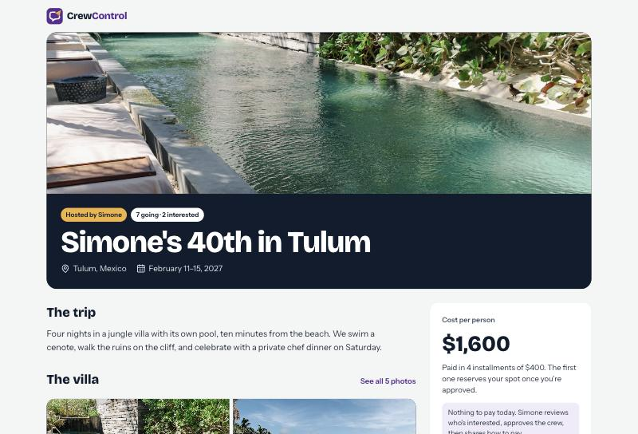
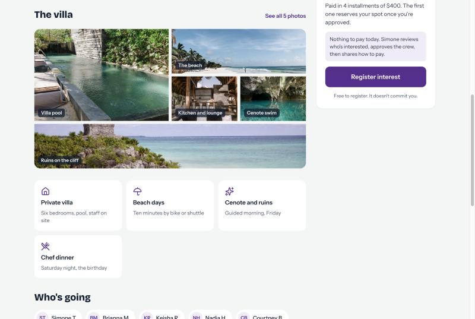
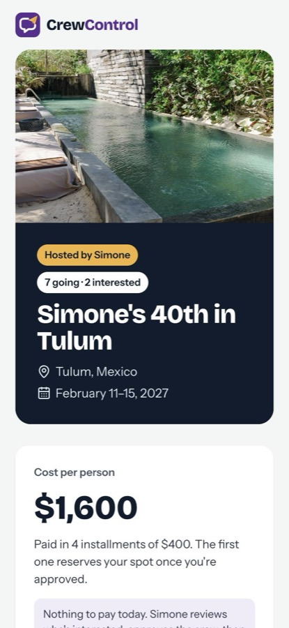

<div align="center">

<picture>
  <source media="(prefers-color-scheme: dark)" srcset="docs/logo-dark.png">
  
</picture>

### Get your trip out the group chat.

**Group trips are run by one friend, a spreadsheet, and a 400-message text thread.**<br>
CrewControl gives that friend a real home base: a trip page people actually want to open,<br>
a clean list of who's in, and a running tab of who's paid. No payment processor. No fees.

<br>



</div>

<br>

## Why it exists

Every group trip has an organizer. They find the house, front the deposit, chase twelve people for Zelle
payments, answer "wait, what day do we fly?" for the fifth time, and track it all in their head.

Booking sites aren't built for them, and neither are travel-agency tools. CrewControl is built for
**the friend who plans the trip**.

## The one rule: we track money, we never touch it

Guests pay the organizer directly, by Zelle, Cash App, Venmo or cash, exactly like they already do.
CrewControl records that the money moved, shows everyone their balance, and reminds them when the next
installment is due.

That means **no processor fees, no held funds, and nothing to connect to your bank.** It's the whole pitch,
and it's a hard line in the code: no checkout, no card entry, ever.

## How a trip runs

```
  Organizer builds the trip page
            │
            ▼
  Friends register interest  ──►  free, commits no one, phone + email required
            │
            ▼
  Organizer approves the crew
            │
            ▼
  Approved guests see how to pay  ──►  first installment locks the spot
            │
            ▼
  Payment plan, reminders and updates run from one place
```

<table>
<tr>
<td width="62%" valign="top">

### A trip page worth sharing

One link for the whole trip: the cover photo, a gallery, the highlights, who's going, key dates, and the
cost per person broken into installments.

It's configured, never templated around one kind of trip. A beach house, an all-inclusive resort, a
cruise or a weekend in a city all use the same page, with the organizer's own photos, highlight cards and
dates.



</td>
<td width="38%" valign="top">

### Built for the phone

That's where the link gets opened.



</td>
</tr>
</table>

<br>

<div align="center">

**Plan the trip. Not the spreadsheet.**

</div>
